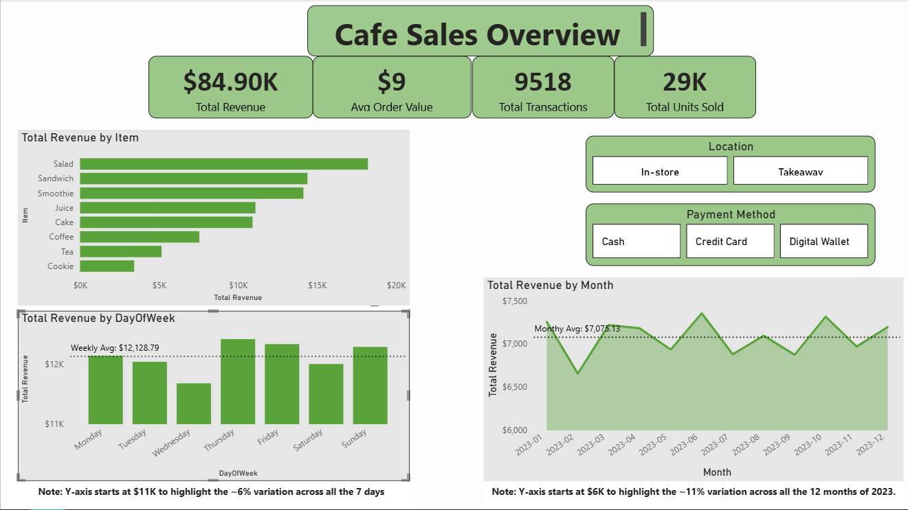

# Cafe Sales: Data Cleaning, EDA and Power BI Dashboard

I turned a deliberately corrupted 10,000-row cafe sales export into a validated, analysis-ready dataset of **9,518 transactions**, then built a Power BI dashboard on top of it. Along the way I found and fixed a silent imputation bug in my own pipeline, and added automated checks so it can't happen again.

---

## Dashboard

 


| At a glance | |
|---|---|
| Rows kept | 9,518 of 10,000 (95.2%) |
| Missing cells | 10,082 before, 0 after |
| Rule checks passed | One price per item, Quantity x Price = Total, no duplicates, valid quantities |
| Total revenue (2023) | $84,901.50 across 28,757 units |
| Reproducible | Seeded random steps; re-running gives the identical file |

---

## Situation

A cafe's point-of-sale export for 2023 (10,000 receipts, 8 columns) was too broken to report on:

- **Fake values:** cells held the text `ERROR` or `UNKNOWN` instead of data, so automated profiling under-reported the damage (6,826 blanks found, versus 10,082 once placeholders were counted).
- **Wrong types:** every column loaded as text, so no totals, averages or date analysis were possible.
- **Heavy gaps in two fields:** Location was missing in 39.6% of rows and Payment Method in 31.8%, far more than any other column. That pattern points to the till not recording them, not to random errors.

## Task

Produce a dataset fit for revenue reporting and a Power BI dashboard, keeping as many real transactions as possible **without inventing facts**. The cleaned file had to meet six rules: no missing values, correct data types, one price per menu item, Quantity x Price = Total on every row, category mixes preserved, and identical output on every run.

My guiding principle: **calculate a value exactly where the other columns allow it, estimate it statistically only where no exact route exists, and drop the row only when neither works.**

## Action

**1. Audit and standardise**
- Profiled the raw file with `ydata-profiling`, `info()` and value counts, which revealed the placeholders and that every item sells at one fixed price.
- Converted every `ERROR` / `UNKNOWN` to `NaN` first, so later steps saw the true extent of missing data.
- Converted numeric and date columns with `errors='coerce'`, so bad values became blanks instead of crashing the pipeline.

**2. Recover values exactly, using the menu's unit economics**

| Missing field | Method | Result |
|---|---|---|
| Price Per Unit | Item's fixed menu price | 533 missing down to 54 |
| Item | Reverse price-to-item map, only for prices unique to one item ($3 and $4 are shared, so skipped) | 969 down to 501 |
| Total Spent / Quantity | Total = Quantity x Price, Quantity = Total / Price | 502 and 479 missing down to 23 each |
| Price Per Unit (no item) | Total / Quantity, accepted only if it matches a menu price | Recovered before any guessing |

**3. Estimate only what can't be calculated**
- Payment Method and Location have no link to any other column, so I used **distribution-preserving random imputation** (each blank drawn from the observed mix). I rejected mode imputation, which would have pushed a third of the rows into one category and distorted every share-based chart.
- For the remaining Items, the draw is **restricted to items sold at the row's known price** (a $3.00 row can only become Cake or Juice).
- A second recovery pass then filled the remaining prices from items and saved 4 more rows.

**4. Remove, validate, and check outliers**
- Dropped 482 rows (4.82%) that could not be recovered, mostly the 460 with no date. A date can't be calculated, and a text placeholder in a numeric column would break every sum.
- The IQR method flagged 259 orders at $25.00 (2.7%). Every one was 5 Salads x $5.00, the largest legitimate order, so all were **kept**: unusual is not the same as wrong.
- Before saving, `assert` checks stop the notebook if any rule fails.

**5. Found and fixed a bug in my own pipeline**

Testing the output against the business rules (not just counting blanks) showed that **355 rows broke them**. 316 had an item at the wrong price (e.g. "Coffee at $3.00"), and 39 had Quantity x Price not equal to Total.

The cause was one step: the Item fill drew from all items and ignored the price already known. I made it price-aware and calculated prices from Total / Quantity first. That fixed all 355 rows with no extra rows dropped. I also seeded every random step, and converted three cells whose syntax errors stopped "Run all" before the save step.

**6. Built and reconciled the dashboard**
- Power BI report with four KPI cards, Location and Payment Method slicers, and revenue by item, day of week and month.
- Refreshed it on the corrected file and replaced two hand-typed average lines with calculated ones, so every figure now updates with the data.

## Result

| Measure | Raw file | Cleaned file |
|---|---|---|
| Rows | 10,000 | 9,518 (482 removed) |
| Missing cells | 10,082 | 0 |
| Columns with correct type | 0 of 8 | 8 of 8 |
| Item vs Price correlation | 0.80 | 1.00 (one price per item, confirmed) |
| Rows breaking Quantity x Price = Total | not checkable | 0 |

**What the data shows**
- **Revenue follows price, not volume.** Every item sells between 1,141 and 1,243 times, so Salad ($5.00) earns the most ($18,220, 21.5% of revenue) and Cookie ($1.00) the least.
- **Most orders are small:** 57% of transactions are between $3 and $10. The average order is $8.92.
- **Sales are flat:** monthly revenue varies about 10% around a $7,075 average, and daily revenue about 6%, with no trend or seasonality.
- **No dominant channel:** Digital Wallet 33.8%, Credit Card 33.3%, Cash 33.0%; Takeaway 50.7%, In-store 49.3%.

**How far to trust those findings:** a third or more of Payment Method and Location was imputed with a method designed to preserve the observed mix, so near-even splits are partly the expected result of that choice. Together with the flat trend and near-uniform item counts, the pattern suggests synthetic data rather than a real cafe. I state the findings at that confidence level.

**Recommendations**
1. **Fix data capture at the till first.** Making Payment Method and Location mandatory fields is the highest-confidence, most actionable finding, whatever the imputed splits show.
2. **Don't favour a payment channel or location yet.** The splits are essentially tied; a non-imputed sample is needed first.
3. **Check the flat trend against a live POS feed** before treating it as a real demand ceiling.

---

## Tech Stack

| Tool | Purpose |
|---|---|
| Python 3 (pandas, NumPy) | Cleaning, imputation, validation |
| Matplotlib, Seaborn, Plotly | Static and interactive charts |
| ydata-profiling | Before and after profiling reports |
| Power BI (DAX) | Interactive dashboard |

## Repository Structure

```
cafe-sales-data-cleaning-eda/
|
|-- Data/
|   |-- dirty_cafe_sales_csv.xls                      # Raw input data
|   |-- Clean_Cafe_Sales_Data.csv                     # Cleaned output (9,518 rows)
|
|-- Doc/
|   |-- Cafe_Sales_Data_Cleaning_Documentation.pdf    # Full STAR write-up with before/after charts
|   |-- Cafe_sales_overview.PNG                       # Dashboard screenshot
|
|-- Dirty_Cafe_Sales_Data_cleaning.ipynb              # Cleaning + EDA notebook
|-- Cafe_Sales_Dashboard.pbix                         # Power BI report
|-- README.md
```

## How to Run

1. Clone the repository.
2. Install dependencies:
   ```bash
   pip install pandas numpy matplotlib seaborn plotly ydata-profiling "numba>=0.64"
   ```
   Numba 0.64 or later is needed for `ydata-profiling` to work with NumPy 2.4 (e.g. in current Google Colab).
3. Open `Dirty_Cafe_Sales_Data_cleaning.ipynb` in Jupyter or Colab and choose **Run all**. The validation cell stops the notebook if any cleaning rule fails.
4. Open `Cafe_Sales_Dashboard.pbix` in Power BI Desktop (free) to explore the dashboard, or see the screenshot above.

Full details of every step, the bug fix and the before/after profiling charts are in [`Doc/Cafe_Sales_Data_Cleaning_Documentation.pdf`](Doc/Cafe_Sales_Data_Cleaning_Documentation.pdf).

## Author

**Urbanus Kathitu** | [github.com/KathituCodes](https://github.com/KathituCodes)
